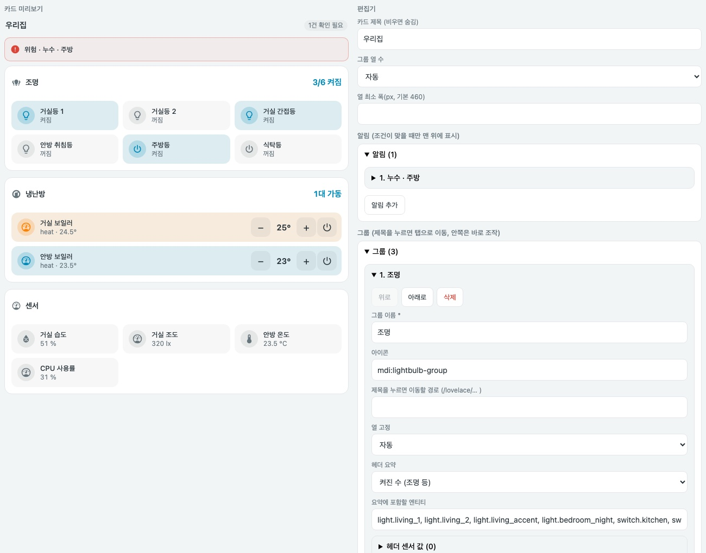

# Overview Cards

[English](README.md) | **한국어**


*실제 카드 JavaScript와 모의 상태로 렌더링했습니다. 로컬 미리보기이며 실제 기기 검증이 아닙니다.*

<details>
<summary>모바일 레이아웃, 어두운 테마, 요약 타일 보기</summary>


</details>

한눈에 훑기 쉽고 바로 조작할 수 있는 대시보드 오버뷰입니다. **그룹**(기본은 탭 단위, 방 단위도 가능)마다 헤더에 굵은 **상태 요약**을 보여주고 아래에 **빠른 조작 칩**을 둡니다. 조명은 눌러서 켜고 끄고, 냉난방은 −/+로 조절하고, 센서는 눌러서 상세를 봅니다. 그룹 제목을 누르면 세부 내용이 있는 탭으로 이동합니다. 맨 위 **알림 띠**는 확인이 필요한 항목만 보여주고, 이상이 없으면 공간을 차지하지 않습니다.

`custom:compact-overview-card` · JavaScript 한 파일 · 다른 카드가 필요 없음(기존 `compact-home-panel` 행은 `items`로 함께 넣을 수 있음)

[카드 가이드](docs/compact-overview-card.md) · [쇼케이스](docs/showcase.md) · [쇼케이스 설정](examples/showcase.yaml) · [기준 문서](STANDARDS.md)

## 시각 편집기

카드 추가 화면에서 카드를 고르면(미리보기가 표시됩니다) UI로 바로 편집할 수 있습니다. 카드 제목과 열 수, 알림, 그룹별 이름·아이콘·탭 이동 경로·헤더 요약(켜진 수, 냉난방, 값 하나)·헤더 센서 값·빠른 조작 칩을 추가, 순서 변경, 삭제할 수 있습니다. compact `items` 행, `tiles`, `status`/`health` 요약 항목은 코드 편집기(YAML)에서 편집하며 편집기를 거쳐도 그대로 보존됩니다. 카드 추가 화면의 기본 구성은 가지고 계신 조명, 냉난방, 센서로 자동 생성됩니다.



## 설치

`compact-overview-card.js`를 `/config/www/`에 복사하고 대시보드 리소스에 JavaScript 모듈로 등록합니다 (`/local/compact-overview-card.js`). 칩은 다른 카드가 필요 없습니다. `items`로 `compact-home-panel` 행을 함께 넣는 경우에만 [Compact Cards](https://github.com/eigger/hass-compact-cards)도 설치하세요. HACS 사용 시 Custom repositories에 이 저장소를 **Dashboard**로 추가합니다.

## 예제

```yaml
type: custom:compact-overview-card
name: 우리집 요약
alerts:                  # 조건이 맞을 때만 표시, 없으면 높이 0
  - entity: binary_sensor.kitchen_leak
    name: 누수 · 주방
    when: { state: "on" }
    level: critical      # warning(기본) | critical
    navigation_path: /lovelace/rooms
sections:
  - name: 조명
    icon: mdi:lightbulb-group
    navigation_path: /lovelace/rooms      # 그룹 제목을 누르면 해당 탭으로 이동
    summary:                              # 헤더의 굵은 상태 요약(타일과 같은 옵션)
      type: count
      entities: [light.living, light.bedroom, switch.kitchen]
    badges:                               # 요약 옆에 표시할 센서 값
      - { entity: sensor.living_illuminance, name: 거실 조도 }
    controls:                             # 빠른 조작 칩
      - { entity: light.living, name: 거실 }
      - { entity: light.bedroom, name: 침실 }
      - { entity: switch.kitchen, name: 주방 }
  - name: 냉난방
    icon: mdi:thermostat
    navigation_path: /lovelace/rooms
    summary: { type: climate, entities: [climate.living_heater, climate.living_ac], value_entity: sensor.living_temperature }
    controls:
      - { entity: climate.living_heater, name: 거실 보일러 }   # −/+와 전원 버튼 내장
      - { entity: climate.living_ac, name: 거실 에어컨 }
```

조작 없는 요약 격자만 원하면 `sections` 대신 `tiles`를 사용합니다. [가이드](docs/compact-overview-card.md)를 참고하세요.

## 그룹 (`sections`)

| 옵션 | 필수 | 설명 |
| --- | --- | --- |
| `name` | 예 | 그룹 제목. `navigation_path`가 있으면 제목이 해당 로컬 경로로 이동하는 버튼이 됩니다 |
| `controls` | 예* | 빠른 조작 칩(아래) |
| `items` | 예* | 칩 아래에 표시할 `compact-home-panel` 행(Compact Cards 필요). `*` `controls`/`items` 중 하나 이상 |
| `icon`, `navigation_path` | 아니요 | 제목 아이콘, 로컬 경로. 경로가 있으면 제목에 `>` 표시가 붙고 눌러서 해당 탭으로 이동 |
| `column` | 아니요 | `1`, `2`, `3`: 그룹을 특정 열에 고정(표시되는 열 수보다 크면 마지막 열) |
| `summary` | 아니요 | `name` 없는 타일 사양(`count`, `climate`, `status`, `value`, `health`). 헤더에 굵게, 수준 색상으로 표시 |
| `badges` | 아니요 | `[{ entity, name }]` 요약 옆 센서 값. 누르면 상세 정보 |

최상위 `section_columns`(`auto`, `1`, `2`, `3`)와 `min_column_width`(280~900, 기본 460)가 그룹 열을 정합니다. `auto`는 들어갈 수 있는 만큼 같은 폭의 열(최대 3)을 쓰고, 640px 미만이거나 한 열만 들어가면 1열로 쌓습니다. **순서:** 그룹은 설정 순서대로, 그때그때 가장 짧은 열에 배치됩니다. 그래서 첫 줄은 1·2·3번 그룹이고 위에서 아래로 훑으면 설정 순서를 따릅니다. 상단이 맞고 열 폭이 같으며 빈틈이 없고, 열 하단은 조금 다를 수 있습니다. 그룹의 `column: 1|2|3`으로 열을 고정할 수 있습니다. PC에서 전체 폭을 쓰려면 Home Assistant 섹션 뷰에서 이 카드가 들어간 섹션에 `column_span`(예: `3`)을 지정하세요.

### 빠른 조작 칩

| 엔티티 | 칩 | 누르면 |
| --- | --- | --- |
| `light`, `switch`, `fan`, `input_boolean`, `humidifier`, `automation` | 상태 색상이 있는 토글 | 켜기/끄기 |
| `climate` | 전체 폭 칩. − / + 목표 온도(마지막 탭 뒤 한 번만 요청, 최소/최대 범위로 제한)와 전원 버튼 | 상세 정보 |
| `button`, `input_button`, `script`, `scene` | 실행 | 누름 / 실행 |
| 그 외(센서, 잠금, 커튼 등) | 값 표시 | 상세 정보 |

칩 옵션: `entity`(필수), `name`, `icon`, `type`(`toggle`, `action`, `readout`, `climate`로 덮어쓰기), `tap_action`(`toggle`, `more-info`, `navigate`+`navigation_path`, `perform-action`+`perform_action`, 선택 `target`·`data`·`confirmation: { text }`). `unavailable` 엔티티는 흐리게 표시하고 서비스를 보내지 않으며 상세 정보는 열 수 있습니다.

## 요약 타일 유형 (`tiles`, 그룹의 `summary`)

| type | 필수 | 표시 |
| --- | --- | --- |
| `count` | `entities` | `켜진 수/확인 가능한 수` |
| `climate` | `entities` (선택 `value_entity`) | `N대 가동` + 대표 온도 |
| `status` | `items[]` (`entity`, 선택 `name`/`active`/`remaining`) | 동작 중인 항목과 남은 시간, 없으면 `idle_text`(기본 `모두 대기`). `active` 기본값은 `[running]` |
| `value` | `entity` (선택 `secondary_entity`, `thresholds`) | 값 + 단위, 임계값 수준 |
| `health` | `items[]` (`problem` 또는 `thresholds` 필수, 선택 `level`) | 최악 수준의 건수와 낮은 수준 건수, 없으면 `이상 없음`. `level`은 `problem`에만 적용되며 기본 `critical` |

타일 옵션: `name`(필수), `icon`, `navigation_path`(없으면 대표 엔티티 상세 정보). 조작 없는 격자는 `tiles`를 쓰며 `columns`(`auto`, `2`, `3`, `4`)는 타일에 적용됩니다.

## 규칙 참고

- `count`는 `on` 상태만 켜짐으로 셉니다(cover의 `open`, lock 등은 세지 않음).
- 임계값은 포함 비교입니다: `above 35`는 35 이상, `below 20`은 20 이하. 숫자가 아닌 값은 무시합니다.
- 알림의 `level` 기본값은 `warning`입니다.
- `secondary_entity`가 `unavailable`이면 보조 줄은 표시하지 않습니다.
- YAML 모드 대시보드에서는 `on`/`off`를 따옴표 없이 쓰면 불리언으로 읽힙니다. 카드가 이를 `on`/`off`로 되돌려 비교하지만 따옴표를 권장합니다.
- 타일 탭은 `navigation_path`로 이동하고, 없으면 동작 중이거나 최악 수준인 엔티티의 상세 정보를 엽니다.
- 최소 Home Assistant 프런트엔드는 `color-mix`와 컨테이너 쿼리를 지원하는 최신 버전을 전제합니다.

## 원칙

- 서비스는 설정한 칩을 눌렀을 때만 호출하며 자동으로 호출하지 않습니다. `unavailable` 엔티티에는 명령을 보내지 않고, 요청 중 중복 탭은 막습니다.
- 정상/위험 기준은 카드가 추측하지 않습니다. `thresholds`, `problem`, `alerts.when`에 사용자가 쓴 규칙만 적용합니다.
- 상태는 색 + `주의 ·`/`위험 ·` 문구 + 아이콘 변화로 함께 전달합니다.
- 일부 엔티티가 `unavailable`이면 분모에서 빼고 `N개 확인 불가`로 따로 표시하며, 정상으로 간주하지 않습니다.
- 타일 순서는 설정 순서를 유지하고 상태에 따라 재배치하지 않습니다.
- 알림이 없으면 알림 영역은 높이를 차지하지 않고, 제목 옆에 `✓ 이상 없음` 배지만 표시합니다.

## 개발

```bash
npm install
npm run check
npm test
```
