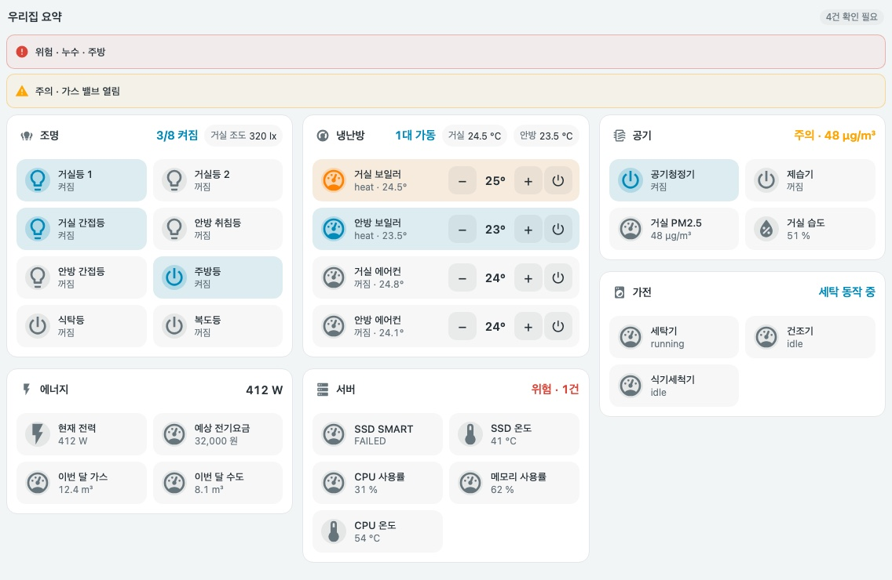
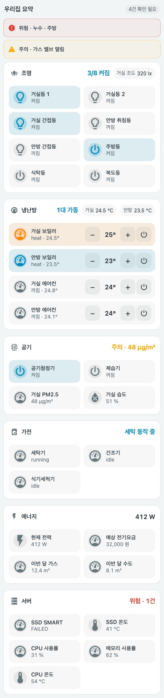
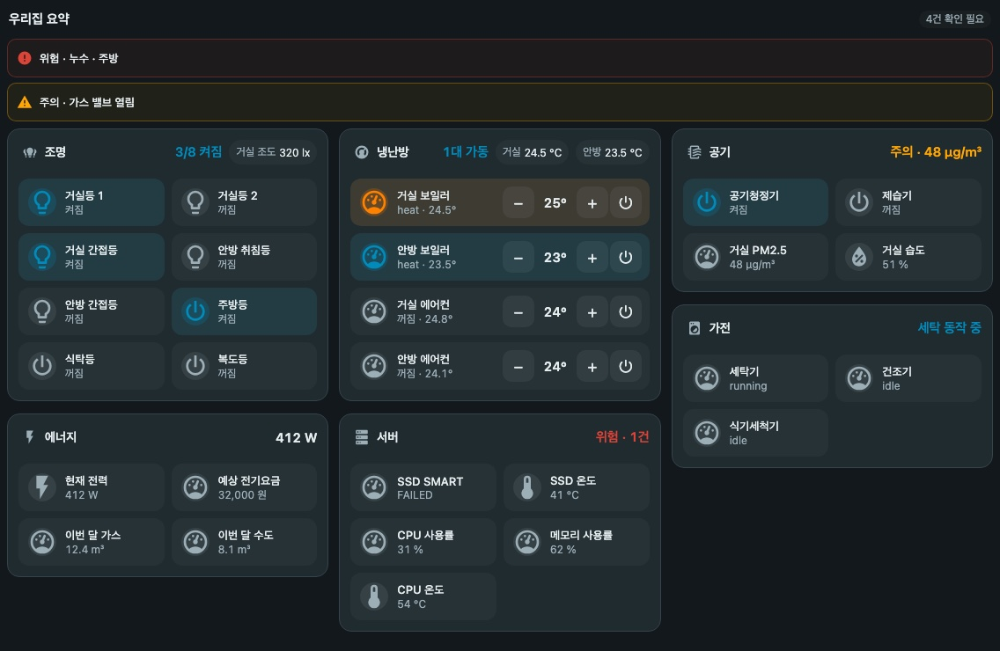
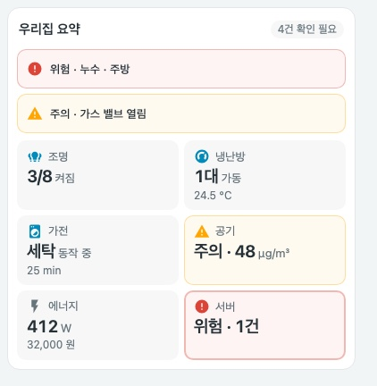

# Overview Cards

[English](README.md) | **한국어**



*실제 카드 JavaScript와 모의 상태로 렌더링했습니다. 로컬 미리보기이며 실제 기기 검증이 아닙니다.*

<details>
<summary>모바일 레이아웃, 어두운 테마, 요약 타일 보기</summary>







</details>

익숙한 오버뷰 구성을 유지하는 카드입니다. **탭(뷰) 단위 섹션의 헤더에 요약을 보여주고 그 아래에 실제 조작 행을 그대로** 두며, 확인이 필요한 항목은 **알림 띠**로 보여줍니다. 조작 행은 [Compact Cards](https://github.com/eigger/hass-compact-cards)의 `compact-home-panel`이라서 오버뷰에서 바로 조명을 켜고 끄고, 냉난방을 조절하고, 센서 상세를 열 수 있습니다.

`custom:compact-overview-card` · JavaScript 한 파일 · 섹션은 Compact Cards의 `compact-cards.js`가 필요합니다(요약 타일은 불필요)

[카드 가이드](docs/compact-overview-card.md) · [쇼케이스](docs/showcase.md) · [쇼케이스 설정](examples/showcase.yaml) · [기준 문서](STANDARDS.md)

## 설치

`compact-overview-card.js`를 `/config/www/`에 복사하고 대시보드 리소스에 JavaScript 모듈로 등록합니다 (`/local/compact-overview-card.js`). 섹션은 `compact-home-panel`을 사용하므로 [Compact Cards](https://github.com/eigger/hass-compact-cards)도 설치하고 리소스를 등록해야 합니다. HACS 사용 시 Custom repositories에 이 저장소를 **Dashboard**로 추가합니다.

## 예제

```yaml
type: custom:compact-overview-card
name: 우리집 요약
alerts:                  # 조건이 맞을 때만 표시, 없으면 높이 0
  - entity: binary_sensor.kitchen_leak
    name: 누수 · 주방
    when: { state: "on" }
    level: critical      # warning(기본) | critical
    navigation_path: /lovelace/rooms
sections:
  - name: 조명
    icon: mdi:lightbulb-group
    navigation_path: /lovelace/rooms      # 섹션 제목을 누르면 해당 탭으로 이동
    columns: 2                            # 조작 행의 열 수: auto | 1 | 2
    summary:                              # 헤더의 한 줄 요약(타일과 같은 옵션)
      type: count
      entities: [light.living, light.bedroom, switch.kitchen]
    badges:                               # 요약 옆에 표시할 센서 값
      - { entity: sensor.living_illuminance, name: 거실 조도 }
    items:                                # compact-home-panel 항목을 그대로 사용
      - { entity: light.living, name: 거실, tap_action: { action: toggle } }
      - { entity: light.bedroom, name: 침실, tap_action: { action: toggle } }
      - { entity: switch.kitchen, name: 주방, tap_action: { action: toggle } }
  - name: 냉난방
    icon: mdi:thermostat
    navigation_path: /lovelace/rooms
    summary: { type: climate, entities: [climate.living_heater, climate.living_ac], value_entity: sensor.living_temperature }
    items:
      - { type: climate, entity: climate.living_heater, name: 거실 보일러 }
      - { type: climate, entity: climate.living_ac, name: 거실 에어컨 }
```

조작 없이 한눈에 보는 요약만 원하면 `sections` 대신 `tiles`를 사용합니다. [가이드](docs/compact-overview-card.md)를 참고하세요.

## 섹션

| 옵션 | 필수 | 설명 |
| --- | --- | --- |
| `name` | 예 | 섹션 제목. `navigation_path`가 있으면 제목이 해당 로컬 경로로 이동하는 버튼이 됩니다 |
| `items` | 예 | `compact-home-panel` 항목(토글, 센서, `type: climate`/`light`/`cover`/`media`, 비교, 이동 등)을 [그 카드](https://github.com/eigger/hass-compact-cards/blob/main/docs/compact-home-panel.md)와 똑같이 사용 |
| `icon`, `navigation_path` | 아니요 | 제목 아이콘, 로컬 경로 |
| `columns` | 아니요 | 조작 행의 열 수: `auto`(기본), `1`, `2` |
| `summary` | 아니요 | `name` 없는 타일 사양(`count`, `climate`, `status`, `value`, `health`). 헤더 오른쪽에 수준 색상으로 표시 |
| `badges` | 아니요 | `[{ entity, name }]` 요약 옆 센서 값. 누르면 상세 정보 |

최상위 `section_columns`(`auto`, `1`, `2`, `3`)는 섹션을 나눌 열 수입니다. `auto`는 카드 너비 640px부터 2열, 960px부터 3열입니다. 잘못된 `items`는 해당 섹션 안에 오류로 표시되고 다른 섹션에는 영향을 주지 않습니다.

## 요약 타일 유형 (`tiles`, 섹션의 `summary`)

| type | 필수 | 표시 |
| --- | --- | --- |
| `count` | `entities` | `켜진 수/확인 가능한 수` |
| `climate` | `entities` (선택 `value_entity`) | `N대 가동` + 대표 온도 |
| `status` | `items[]` (`entity`, 선택 `name`/`active`/`remaining`) | 동작 중인 항목과 남은 시간, 없으면 `idle_text`(기본 `모두 대기`). `active` 기본값은 `[running]` |
| `value` | `entity` (선택 `secondary_entity`, `thresholds`) | 값 + 단위, 임계값 수준 |
| `health` | `items[]` (`problem` 또는 `thresholds` 필수, 선택 `level`) | 최악 수준의 건수와 낮은 수준 건수, 없으면 `이상 없음`. `level`은 `problem`에만 적용되며 기본 `critical` |

타일 옵션: `name`(필수), `icon`, `navigation_path`(없으면 대표 엔티티 상세 정보). 조작 없는 격자는 `tiles`를 쓰며 `columns`(`auto`, `2`, `3`, `4`)는 타일에 적용됩니다.

## 규칙 참고

- `count`는 `on` 상태만 켜짐으로 셉니다(cover의 `open`, lock 등은 세지 않음).
- 임계값은 포함 비교입니다: `above 35`는 35 이상, `below 20`은 20 이하. 숫자가 아닌 값은 무시합니다.
- 알림의 `level` 기본값은 `warning`입니다.
- `secondary_entity`가 `unavailable`이면 보조 줄은 표시하지 않습니다.
- YAML 모드 대시보드에서는 `on`/`off`를 따옴표 없이 쓰면 불리언으로 읽힙니다. 카드가 이를 `on`/`off`로 되돌려 비교하지만 따옴표를 권장합니다.
- 타일 탭은 `navigation_path`로 이동하고, 없으면 동작 중이거나 최악 수준인 엔티티의 상세 정보를 엽니다.
- 최소 Home Assistant 프런트엔드는 `color-mix`와 컨테이너 쿼리를 지원하는 최신 버전을 전제합니다.

## 원칙

- 카드 자체는 서비스를 호출하지 않습니다. 섹션의 조작은 설정한 `compact-home-panel` 행이 수행합니다.
- 정상/위험 기준은 카드가 추측하지 않습니다. `thresholds`, `problem`, `alerts.when`에 사용자가 쓴 규칙만 적용합니다.
- 상태는 색 + `주의 ·`/`위험 ·` 문구 + 아이콘 변화로 함께 전달합니다.
- 일부 엔티티가 `unavailable`이면 분모에서 빼고 `N개 확인 불가`로 따로 표시하며, 정상으로 간주하지 않습니다.
- 타일 순서는 설정 순서를 유지하고 상태에 따라 재배치하지 않습니다.
- 알림이 없으면 알림 영역은 높이를 차지하지 않고, 제목 옆에 `✓ 이상 없음` 배지만 표시합니다.

## 개발

```bash
npm install
npm run check
npm test
```
