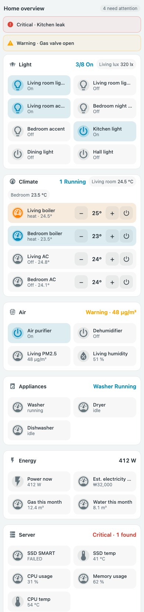
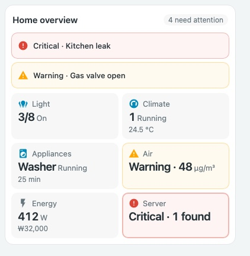

# Overview Cards

**English** | [한국어](README.ko.md)


*Rendered with the actual card JavaScript and mocked states. This is a local preview, not live-device verification.*

<details>
<summary>View the mobile layout, the dark theme and the summary-tile variant</summary>






</details>

An overview page for Home Assistant that keeps the familiar layout: **sections that group controls (by default one section per dashboard tab, or per room if you prefer), each with a summary in the header and the real controls underneath**, plus an **alert strip** for things that need attention. Controls are [Compact Cards](https://github.com/eigger/hass-compact-cards) `compact-home-panel` rows, so lights toggle, climate adjusts and sensors open their details right on the overview.

`custom:compact-overview-card` · one JavaScript file · no other card required (existing `compact-home-panel` rows can still be embedded with `items`)

[Card guide](docs/compact-overview-card.md) · [Showcase](docs/showcase.md) · [Showcase configuration](examples/showcase.yaml) · [Standards reference](STANDARDS.md)

## Installation

Install through HACS **Custom repositories** (category **Dashboard**), or copy `compact-overview-card.js` to `/config/www/` and register `/local/compact-overview-card.js` as a JavaScript module in dashboard resources. This project is not in the default HACS catalog.

Chips need nothing else. Only if you embed `compact-home-panel` rows with `items`, also install [Compact Cards](https://github.com/eigger/hass-compact-cards). It uses `color-mix` and container queries, so it needs a recent Home Assistant frontend.

## Example

```yaml
type: custom:compact-overview-card
name: Home
alerts:                  # shown only while the condition matches; zero height otherwise
  - entity: binary_sensor.kitchen_leak
    name: Kitchen leak
    when: { state: "on" }
    level: critical      # warning (default) | critical
    navigation_path: /lovelace/rooms
sections:
  - name: Lights
    icon: mdi:lightbulb-group
    navigation_path: /lovelace/rooms      # tapping the group title opens that tab
    summary:                              # bold status in the header (same options as a tile)
      type: count
      entities: [light.living, light.bedroom, switch.kitchen]
    badges:                               # optional readings next to the summary
      - { entity: sensor.living_illuminance, name: Living lux }
    controls:                             # quick-control chips
      - { entity: light.living, name: Living room }
      - { entity: light.bedroom, name: Bedroom }
      - { entity: switch.kitchen, name: Kitchen }
  - name: Climate
    icon: mdi:thermostat
    navigation_path: /lovelace/rooms
    summary: { type: climate, entities: [climate.living_heater, climate.living_ac], value_entity: sensor.living_temperature }
    controls:
      - { entity: climate.living_heater, name: Living boiler }   # −/+ and power built in
      - { entity: climate.living_ac, name: Living AC }
```

Prefer a controls-free summary grid? Use `tiles` instead of `sections`; see [the guide](docs/compact-overview-card.md).

## Groups (`sections`)

| Option | Required | Description |
| --- | --- | --- |
| `name` | yes | Group title. With `navigation_path` the title is a button that opens that local path |
| `controls` | yes* | Quick-control chips (below) |
| `items` | yes* | Optional `compact-home-panel` rows shown under the chips (needs Compact Cards). `*` at least one of `controls`/`items` |
| `icon`, `navigation_path` | no | Title icon and local path |
| `span` | no | `2` or `3`: let the group take that many columns when the card is at least 700px (1050px for 3), for example so climate rows fit on one line. Ignored on narrower cards |
| `summary` | no | A tile spec without `name` (`count`, `climate`, `status`, `value`, `health`); shown bold in the header, coloured by level |
| `badges` | no | `[{ entity, name }]` readings next to the summary; tap opens the entity |

Top-level `section_columns` (`auto`, `1`, `2`, `3`) sets the group columns. `auto` fills the width with groups at least 320px wide, packed from the top at their natural height with no blank space inside cards or gaps between them; on mobile it is a single column. Put the card in a section with `column_span` (for example `3`) in Home Assistant's sections view to use the full width on a PC.

### Quick-control chips

| Entity | Chip | Tap |
| --- | --- | --- |
| `light`, `switch`, `fan`, `input_boolean`, `humidifier`, `automation` | Toggle with state colour | Toggles |
| `climate` | Full-width chip with − / + target temperature (one request after the last tap, clamped to min/max) and a power button | Opens details |
| `button`, `input_button`, `script`, `scene` | Action | Presses / runs |
| anything else (sensors, locks, covers…) | Readout | Opens details |

Per chip: `entity` (required), `name`, `icon`, `type` (`toggle`, `action`, `readout`, `climate` to override), and `tap_action` (`toggle`, `more-info`, `navigate` with `navigation_path`, or `perform-action` with `perform_action`, optional `target`, `data` and `confirmation: { text }`). Unavailable entities are dimmed and never sent a service call; their details still open.

## Summary tile types (`tiles`, and `summary` of a section)

| type | Required | Shows |
| --- | --- | --- |
| `count` | `entities` | `on / available` |
| `climate` | `entities` (optional `value_entity`) | `N running`, or standby / off, plus a representative reading |
| `status` | `items[]` (`entity`; optional `name`, `active`, `remaining`) | Running items and remaining time, otherwise `idle_text`. `active` defaults to `[running]` |
| `value` | `entity` (optional `secondary_entity`, `thresholds`) | Value, unit and threshold level |
| `health` | `items[]` (`problem` or `thresholds` required; optional `level`) | Count at the worst level plus lower-level count, otherwise "no issues". `level` applies to `problem` only and defaults to `critical` |

Tile options: `name` (required), `icon`, `navigation_path`. Use `tiles` for a controls-free grid; `columns` (`auto`, `2`, `3`, `4`) applies to tiles.

## Rules

- `count` counts only the `on` state (not `open` covers, locks and so on).
- Thresholds are inclusive: `above 35` matches 35, `below 20` matches 20. Non-numeric values are ignored.
- Alert `level` defaults to `warning`.
- When `secondary_entity` is unavailable, the secondary line is hidden.
- In YAML-mode dashboards an unquoted `on`/`off` is read as a boolean. The card maps it back, but quoting is recommended.
- Tapping a tile follows `navigation_path`; without one it opens the entity that explains the summary (the running item or the worst item).

## Principles

- The card never guesses what is normal. Only your `thresholds`, `problem` and `when` rules apply.
- Services are called only by chips you configured and only on a tap, never automatically. Unavailable entities are never sent commands, and duplicate taps are blocked while a request is running.
- Status is conveyed by color, a `주의 ·` / `위험 ·` text prefix and an icon change together.
- Unavailable entities are counted separately, never treated as healthy.
- Tile order follows your configuration and never reshuffles with state.
- With no alerts the alert area takes no height; only a `✓ 이상 없음` badge remains beside the title.

## Development

```bash
npm install
npm run check
npm test
```
