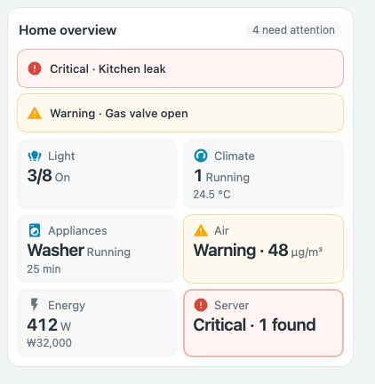
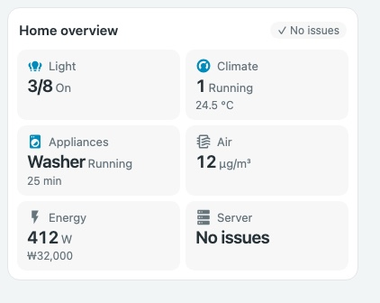
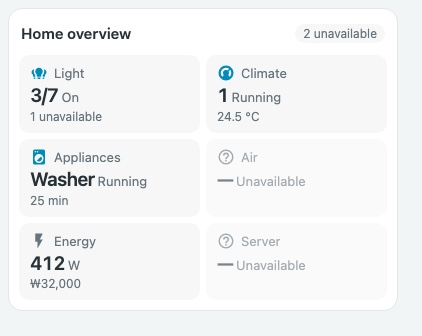
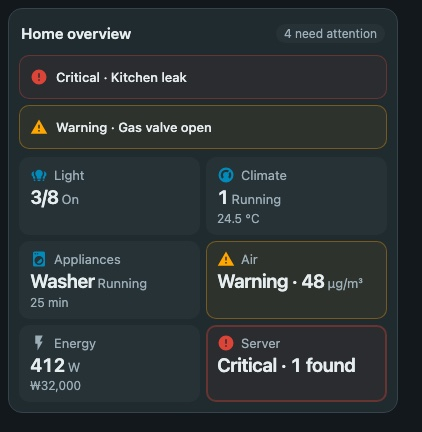

# Overview Cards

**English** | [한국어](README.ko.md)



*Rendered with the actual card JavaScript and mocked states. This is a local preview, not live-device verification.*

<details>
<summary>View the other states and the dark theme</summary>







</details>

[Card guide](docs/compact-overview-card.md) · [Showcase](docs/showcase.md) · [Showcase configuration](examples/showcase.yaml) · [Standards reference](STANDARDS.md)

Summary cards for a Home Assistant overview page. Details stay in room and device views; the overview shows **one-line summaries per category** and **alerts that need attention**.

`custom:compact-overview-card` · one JavaScript file, no build step or runtime dependencies · read-only (never calls services)

## Installation

Install through HACS **Custom repositories** (category **Dashboard**), or copy `compact-overview-card.js` to `/config/www/` and register `/local/compact-overview-card.js` as a JavaScript module in dashboard resources. This project is not in the default HACS catalog.

It uses `color-mix` and container queries, so it needs a recent Home Assistant frontend.

## Example

```yaml
type: custom:compact-overview-card
name: Home
columns: auto            # auto | 2 | 3 | 4
alerts:                  # shown only while the condition matches; zero height otherwise
  - entity: binary_sensor.kitchen_leak
    name: Kitchen leak
    when: { state: "on" }
    level: critical      # warning (default) | critical
    navigation_path: /lovelace/rooms
tiles:
  - type: count
    name: Lights
    icon: mdi:lightbulb-group
    entities: [light.living, light.bedroom, switch.kitchen]
    navigation_path: /lovelace/rooms
  - type: climate
    name: Climate
    icon: mdi:thermostat
    entities: [climate.living_heater, climate.living_ac]
    value_entity: sensor.living_temperature
  - type: status
    name: Appliances
    icon: mdi:washing-machine
    idle_text: All idle
    items:
      - { entity: sensor.washer_state, name: Washer, active: [running], remaining: sensor.washer_remaining }
  - type: value
    name: Air
    icon: mdi:air-filter
    entity: sensor.pm2_5
    thresholds:
      - { value: 35, direction: above, level: warning }
      - { value: 75, direction: above, level: critical }
  - type: health
    name: Server
    icon: mdi:server
    items:
      - { entity: sensor.ssd_smart, problem: { state_not: PASSED }, level: critical }
      - { entity: sensor.cpu_temp, thresholds: [{ value: 75, direction: above, level: warning }] }
```

## Tile types

| type | Required | Shows |
| --- | --- | --- |
| `count` | `entities` | `on / available` |
| `climate` | `entities` (optional `value_entity`) | `N running`, or standby / off, plus a representative reading |
| `status` | `items[]` (`entity`; optional `name`, `active`, `remaining`) | Running items and remaining time, otherwise `idle_text`. `active` defaults to `[running]` |
| `value` | `entity` (optional `secondary_entity`, `thresholds`) | Value, unit and threshold level |
| `health` | `items[]` (`problem` or `thresholds` required; optional `level`) | Count at the worst level plus lower-level count, otherwise "no issues". `level` applies to `problem` only and defaults to `critical` |

Common options: `name` (required), `icon`, `navigation_path`.

## Rules

- `count` counts only the `on` state (not `open` covers, locks and so on).
- Thresholds are inclusive: `above 35` matches 35, `below 20` matches 20. Non-numeric values are ignored.
- Alert `level` defaults to `warning`.
- When `secondary_entity` is unavailable, the secondary line is hidden.
- In YAML-mode dashboards an unquoted `on`/`off` is read as a boolean. The card maps it back, but quoting is recommended.
- Tapping a tile follows `navigation_path`; without one it opens the entity that explains the summary (the running item or the worst item).

## Principles

- The card never guesses what is normal. Only your `thresholds`, `problem` and `when` rules apply.
- Status is conveyed by color, a `주의 ·` / `위험 ·` text prefix and an icon change together.
- Unavailable entities are counted separately, never treated as healthy.
- Tile order follows your configuration and never reshuffles with state.
- With no alerts the alert area takes no height; only a `✓ 이상 없음` badge remains beside the title.

## Development

```bash
npm install
npm run check
npm test
```
