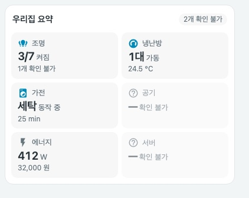

# Compact overview card — 오버뷰 요약


방과 기기별 상세 제어는 하위 뷰에 맡기고, 홈 화면에서는 **카테고리별 한 줄 요약**과 **확인이 필요한 알림**만 보여줍니다. 이미지는 모의 상태를 사용하는 로컬 미리보기이며 실제 화면은 설정과 카드 너비에 따라 달라집니다.

<details>
<summary>정상·연결 불가·어두운 테마</summary>





</details>

## 기본 설정

```yaml
type: custom:compact-overview-card
name: 우리집 요약
alerts:
  - entity: binary_sensor.kitchen_leak
    name: 누수 · 주방
    when: { state: "on" }
    level: critical
tiles:
  - type: count
    name: 조명
    icon: mdi:lightbulb-group
    entities: [light.living_room, light.bedroom]
    navigation_path: /lovelace/rooms
```

전체 구성은 [showcase.yaml](../examples/showcase.yaml)과 [쇼케이스 가이드](showcase.md)를 참고하세요.

## 카드 옵션

| 옵션 | 필수 | 기본값 | 설명 |
| --- | --- | --- | --- |
| `type` | 예 | — | `custom:compact-overview-card` |
| `tiles` | 예 | — | 하나 이상의 타일 |
| `name` | 아니요 | 없음 | 카드 제목 |
| `columns` | 아니요 | `auto` | `auto` 또는 `2`, `3`, `4`. `auto`는 카드 너비 421px부터 3열, 700px부터 4열 |
| `alerts` | 아니요 | 없음 | 조건이 맞을 때만 표시하는 알림 목록 |

## 타일 유형

| `type` | 필수 | 선택 | 표시 |
| --- | --- | --- | --- |
| `count` | `entities` | | `켜진 수/확인 가능한 수`. `on` 상태만 켜짐으로 셉니다 |
| `climate` | `entities` | `value_entity` | `N대 가동`, 켜져 있지만 쉬는 중이면 `대기`, 모두 꺼지면 `꺼짐`, 대표 값 한 줄 |
| `status` | `items[]` | `idle_text` | 동작 중인 항목과 남은 시간. 동작 중인 항목이 없으면 `idle_text`(기본 `모두 대기`) |
| `value` | `entity` | `secondary_entity`, `thresholds` | 값과 단위, 임계값 수준 |
| `health` | `items[]` | | 가장 나쁜 수준의 건수와 낮은 수준 건수. 문제가 없으면 `이상 없음` |

공통 옵션은 `name`(필수), `icon`, `navigation_path`입니다. `navigation_path`는 `/`로 시작하는 로컬 경로만 허용합니다. 경로가 없으면 동작 중이거나 최악 수준인 엔티티의 상세 정보를 엽니다.

`status.items[]`는 `entity`(필수), `name`, `active`(기본 `[running]`), `remaining`(남은 시간 엔티티)을 가집니다. `health.items[]`는 `entity`(필수)와 `problem`(`{state}` 또는 `{state_not}`) 또는 `thresholds` 중 하나 이상이 필요하며, `level`(기본 `critical`)은 `problem`에만 적용됩니다.

## 알림

`alerts[]`는 `entity`와 `when`(`{state}` 또는 `{state_not}`)이 필요하고, `name`, `level`(`warning` 기본, `critical`), `navigation_path`를 지정할 수 있습니다. 조건이 맞는 알림만 위험 순으로 표시하고, 하나도 없으면 높이를 차지하지 않습니다. 제목 옆 배지는 `✓ 이상 없음`, `N건 확인 필요`, `N개 확인 불가`를 알려 줍니다.

## 임계값

`thresholds[]`는 `value`(숫자), `direction`(`above` 또는 `below`), `level`(`warning` 또는 `critical`)을 가지며 포함 비교입니다. `above 35`는 35 이상, `below 20`은 20 이하입니다. 숫자가 아닌 값은 무시하고, 동시에 맞으면 `critical`이 우선합니다. 카드는 정상·위험 기준을 추측하지 않으므로 직접 지정한 규칙만 적용합니다.

## 상태 표시와 접근성

- 수준은 색상, `주의 ·`/`위험 ·` 문구, 아이콘 변화로 함께 전달합니다.
- `unavailable`/`unknown` 엔티티는 정상으로 보지 않고 `N개 확인 불가`로 따로 표시합니다. 모두 확인할 수 없으면 `—`와 `확인 불가`를 표시합니다.
- 타일은 하나의 버튼이며 전체 요약을 `aria-label`과 툴팁으로 제공합니다. 알림 영역은 `aria-live`로 변화를 알립니다.
- 타일 순서는 설정 순서를 유지하고 상태에 따라 재배치하지 않습니다.
- 카드는 서비스를 호출하지 않는 읽기 전용입니다.
- YAML 모드 대시보드에서 따옴표 없는 `on`/`off`는 불리언으로 읽힙니다. 카드가 `on`/`off`로 되돌려 비교하지만 따옴표를 권장합니다.

## English


The overview card keeps room and device controls in sub-views and shows only **one-line summaries per category** and **alerts that need attention** on the home screen. The images use mocked states.

Options: `tiles` (required), `name`, `columns` (`auto`, `2`, `3`, `4`; `auto` switches to 3 columns from 421px and 4 from 700px) and `alerts`. Tile types: `count` (`on / available`), `climate` (`N running`, standby, off), `status` (running items with remaining time, otherwise `idle_text`), `value` (reading with thresholds) and `health` (worst level count, otherwise "no issues"). `navigation_path` accepts local paths starting with `/` only; without one, tapping opens the entity that explains the summary.

Alerts need `entity` and `when` (`{state}` or `{state_not}`) and appear only while they match, most severe first; with none, the alert area takes no height. Thresholds are inclusive and `critical` wins when both match. The card never guesses what is normal, shows unavailable entities separately instead of treating them as healthy, keeps tile order fixed, and never calls services.
