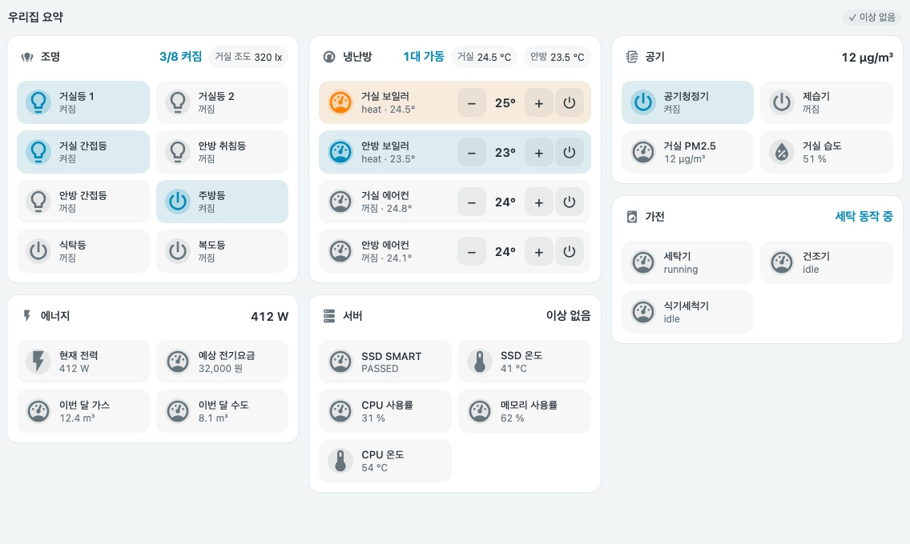

# Compact overview card — 오버뷰 요약


한눈에 훑기 쉽고 바로 조작할 수 있는 오버뷰입니다. 그룹(기본은 탭 단위)마다 헤더에 굵은 상태 요약을 보여주고 아래에 빠른 조작 칩을 둡니다. 제목을 누르면 세부 내용이 있는 탭으로 이동하고, 확인이 필요한 항목은 위쪽 알림 띠에 모입니다. 조작 없는 요약 격자가 필요하면 `tiles`를 사용합니다. 이미지는 모의 상태를 사용하는 로컬 미리보기이며 실제 화면은 설정과 카드 너비에 따라 달라집니다.

<details>
<summary>모바일, 어두운 테마, 정상 상태, 요약 타일</summary>





</details>

## 기본 설정

```yaml
type: custom:compact-overview-card
name: 우리집 요약
alerts:
  - entity: binary_sensor.kitchen_leak
    name: 누수 · 주방
    when: { state: "on" }
    level: critical
sections:
  - name: 조명
    icon: mdi:lightbulb-group
    navigation_path: /lovelace/rooms
    summary:
      type: count
      entities: [light.living_room, light.bedroom]
    controls:
      - { entity: light.living_room, name: 거실 }
      - { entity: light.bedroom, name: 침실 }
  - name: 냉난방
    icon: mdi:thermostat
    navigation_path: /lovelace/rooms
    summary: { type: climate, entities: [climate.living_heater], value_entity: sensor.living_temperature }
    controls:
      - { entity: climate.living_heater, name: 거실 보일러 }
```

전체 구성은 [showcase.yaml](../examples/showcase.yaml)과 [쇼케이스 가이드](showcase.md)를 참고하세요.

## 그룹

그룹은 기본적으로 대시보드 **탭 하나**를 요약하고(제목을 누르면 그 탭으로 이동), 방 단위로 묶어도 됩니다. 그룹마다 헤더에는 굵은 상태 요약이, 아래에는 빠른 조작 칩이 나옵니다.

| 옵션 | 필수 | 기본값 | 설명 |
| --- | --- | --- | --- |
| `name` | 예 | — | 그룹 제목. `navigation_path`가 있으면 제목이 이동 버튼 |
| `controls` | 예* | — | 빠른 조작 칩 목록 |
| `items` | 예* | — | 칩 아래에 표시할 `compact-home-panel` 행([해당 카드](https://github.com/eigger/hass-compact-cards/blob/main/docs/compact-home-panel.md)와 동일, Compact Cards 필요). `*` 둘 중 하나 이상 |
| `icon` | 아니요 | `mdi:circle-outline` | 제목 아이콘 |
| `navigation_path` | 아니요 | 없음 | `/`로 시작하는 로컬 경로 |
| `span` | 아니요 | `1` | `2` 또는 `3`. 카드 폭 700px 이상(3은 1050px 이상)에서 그룹이 여러 열을 차지해 냉난방 행처럼 넓은 행이 한 줄에 표시됩니다. 좁은 카드(모바일)에서는 무시합니다 |
| `columns` | 아니요 | `auto` | `items`의 열 수 `auto`, `1`, `2` |
| `summary` | 아니요 | 없음 | `name` 없는 타일 사양. 헤더에 `3/8 켜짐`, `주의 · 48 µg/m³` 형태로 표시 |
| `badges` | 아니요 | 없음 | `[{entity, name}]`. 헤더의 센서 값. 누르면 상세 정보 |

그룹은 원래 높이 그대로 위에서부터 빈틈 없이 쌓습니다(카드 안에 빈 공간이 생기지 않음). 모바일에서는 1열입니다.

## 빠른 조작 칩

| 엔티티 | 칩 | 누르면 |
| --- | --- | --- |
| `light`, `switch`, `fan`, `input_boolean`, `humidifier`, `automation` | 상태 색상이 있는 토글 | 켜기/끄기(`homeassistant.toggle`) |
| `climate` | 전체 폭. 목표 온도 − / +와 전원 버튼 | 상세 정보 |
| `button`, `input_button`, `script`, `scene` | 실행 칩 | `button.press`, `input_button.press`, `script.turn_on`, `scene.turn_on` |
| 그 외 | 값 표시 칩 | 상세 정보 |

- 냉난방의 −/+는 `target_temp_step`(없으면 0.5)과 `min_temp`/`max_temp` 범위를 따르고, 마지막 탭 뒤 약 0.45초 뒤에 `climate.set_temperature`를 한 번만 보냅니다. 전원 버튼은 `climate.turn_on`/`turn_off`입니다.
- 칩 옵션: `entity`(필수), `name`, `icon`, `type`(`toggle`, `action`, `readout`, `climate`), `tap_action`(`toggle`, `more-info`, `navigate`+`navigation_path`, `perform-action`+`perform_action`/`target`/`data`/`confirmation.text`).
- `unavailable`/`unknown` 엔티티는 흐리게 표시하고 서비스를 보내지 않습니다. 상세 정보는 열 수 있습니다. 요청 중에는 중복 탭을 막고 실패하면 칩 위쪽에 잠깐 오류 선을 표시하며 알림 이벤트를 보냅니다.

## 카드 옵션

| 옵션 | 필수 | 기본값 | 설명 |
| --- | --- | --- | --- |
| `type` | 예 | — | `custom:compact-overview-card` |
| `sections` | 예* | — | 그룹 목록(기본은 탭 단위, 방 단위도 가능) |
| `tiles` | 예* | — | 조작 없는 요약 타일 목록. `*` `sections`와 `tiles` 중 하나 이상 필요 |
| `name` | 아니요 | 없음 | 카드 제목 |
| `columns` | 아니요 | `auto` | 타일 열 수 `auto`, `2`, `3`, `4`. `auto`는 카드 너비 421px부터 3열, 700px부터 4열 |
| `section_columns` | 아니요 | `auto` | 그룹 열 수 `auto`, `1`, `2`, `3`. `auto`는 폭 320px 이상 그룹을 가로로 채움. PC에서 전체 폭을 쓰려면 이 카드가 있는 섹션에 `column_span`을 지정 |
| `alerts` | 아니요 | 없음 | 조건이 맞을 때만 표시하는 알림 목록 |

## 요약 타일 유형 (`tiles`와 그룹의 `summary`)

| `type` | 필수 | 선택 | 표시 |
| --- | --- | --- | --- |
| `count` | `entities` | | `켜진 수/확인 가능한 수`. `on` 상태만 켜짐으로 셉니다 |
| `climate` | `entities` | `value_entity` | `N대 가동`, 켜져 있지만 쉬는 중이면 `대기`, 모두 꺼지면 `꺼짐`, 대표 값 한 줄 |
| `status` | `items[]` | `idle_text` | 동작 중인 항목과 남은 시간. 동작 중인 항목이 없으면 `idle_text`(기본 `모두 대기`) |
| `value` | `entity` | `secondary_entity`, `thresholds` | 값과 단위, 임계값 수준 |
| `health` | `items[]` | | 가장 나쁜 수준의 건수와 낮은 수준 건수. 문제가 없으면 `이상 없음` |

공통 옵션은 `name`(필수), `icon`, `navigation_path`입니다. `navigation_path`는 `/`로 시작하는 로컬 경로만 허용합니다. 경로가 없으면 동작 중이거나 최악 수준인 엔티티의 상세 정보를 엽니다.

`status.items[]`는 `entity`(필수), `name`, `active`(기본 `[running]`), `remaining`(남은 시간 엔티티)을 가집니다. `health.items[]`는 `entity`(필수)와 `problem`(`{state}` 또는 `{state_not}`) 또는 `thresholds` 중 하나 이상이 필요하며, `level`(기본 `critical`)은 `problem`에만 적용됩니다.

## 알림

`alerts[]`는 `entity`와 `when`(`{state}` 또는 `{state_not}`)이 필요하고, `name`, `level`(`warning` 기본, `critical`), `navigation_path`를 지정할 수 있습니다. 조건이 맞는 알림만 위험 순으로 표시하고, 하나도 없으면 높이를 차지하지 않습니다. 제목 옆 배지는 `✓ 이상 없음`, `N건 확인 필요`, `N개 확인 불가`를 알려 줍니다.

## 임계값

`thresholds[]`는 `value`(숫자), `direction`(`above` 또는 `below`), `level`(`warning` 또는 `critical`)을 가지며 포함 비교입니다. `above 35`는 35 이상, `below 20`은 20 이하입니다. 숫자가 아닌 값은 무시하고, 동시에 맞으면 `critical`이 우선합니다. 카드는 정상·위험 기준을 추측하지 않으므로 직접 지정한 규칙만 적용합니다.

## 상태 표시와 접근성

- 수준은 색상, `주의 ·`/`위험 ·` 문구, 아이콘 변화로 함께 전달합니다.
- `unavailable`/`unknown` 엔티티는 정상으로 보지 않고 `N개 확인 불가`로 따로 표시합니다. 모두 확인할 수 없으면 `—`와 `확인 불가`를 표시합니다.
- 타일은 하나의 버튼이며 전체 요약을 `aria-label`과 툴팁으로 제공합니다. 알림 영역은 `aria-live`로 변화를 알립니다.
- 타일 순서는 설정 순서를 유지하고 상태에 따라 재배치하지 않습니다.
- 서비스는 설정한 칩을 눌렀을 때만 호출하며 자동으로 호출하지 않습니다.
- YAML 모드 대시보드에서 따옴표 없는 `on`/`off`는 불리언으로 읽힙니다. 카드가 `on`/`off`로 되돌려 비교하지만 따옴표를 권장합니다.

## English


The overview card is a tidy, scannable overview you can also operate. Each group (by default one per dashboard tab) shows a bold status summary in its header and quick-control chips underneath: tap a light to toggle it, step a thermostat with −/+, tap a sensor for details; tapping the title opens the tab. Alerts on top appear only when needed. The images use mocked states.

Groups (`sections[]`: `name`, `controls` and/or `items`, optional `icon`, `navigation_path`, `summary`, `badges`; `items` embed `compact-home-panel` and need Compact Cards). Chips: toggle for lights/switches/fans, −/+ and power for climate, press for buttons/scripts/scenes, readout otherwise, each overridable with `tap_action`. Options: `sections` and/or `tiles` (at least one), `name`, `columns` (`auto`, `2`, `3`, `4`; `auto` switches to 3 columns from 421px and 4 from 700px) and `alerts`. Tile types: `count` (`on / available`), `climate` (`N running`, standby, off), `status` (running items with remaining time, otherwise `idle_text`), `value` (reading with thresholds) and `health` (worst level count, otherwise "no issues"). `navigation_path` accepts local paths starting with `/` only; without one, tapping opens the entity that explains the summary.

Alerts need `entity` and `when` (`{state}` or `{state_not}`) and appear only while they match, most severe first; with none, the alert area takes no height. Thresholds are inclusive and `critical` wins when both match. The card never guesses what is normal, shows unavailable entities separately instead of treating them as healthy, keeps tile order fixed, and calls services only for chips you configured, on a tap.
